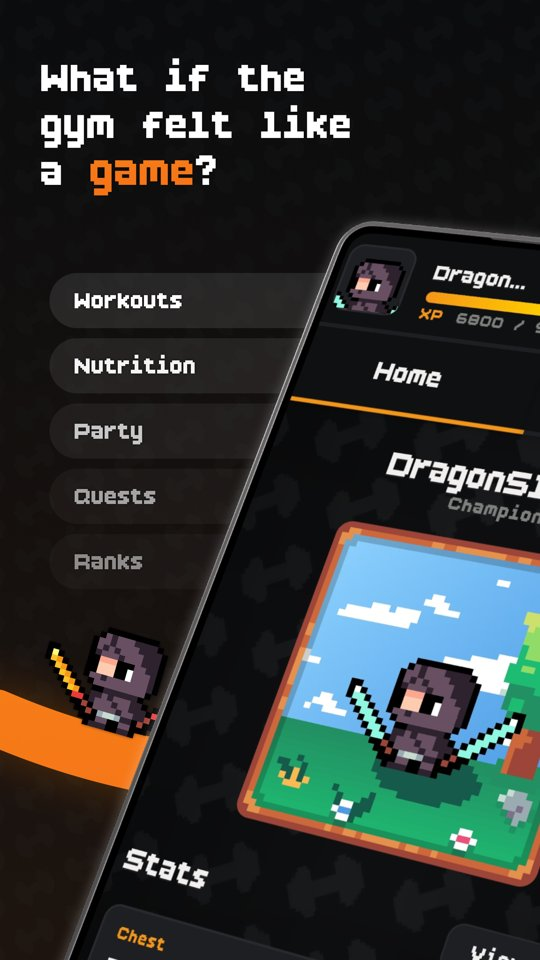
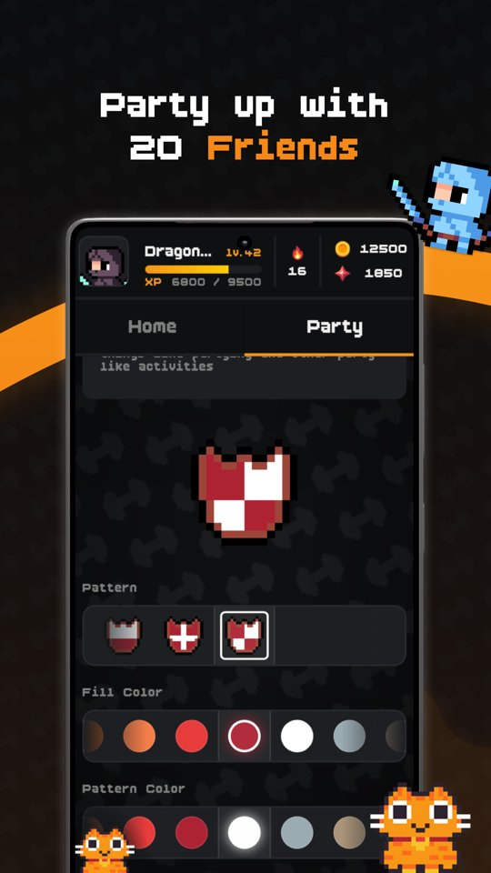
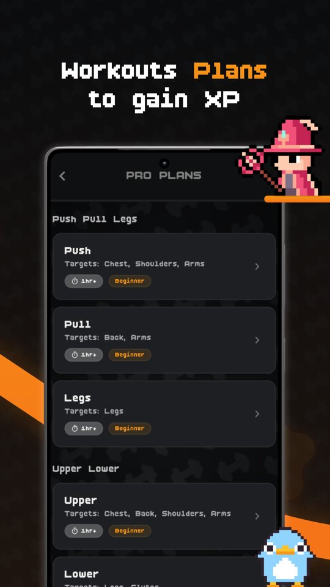
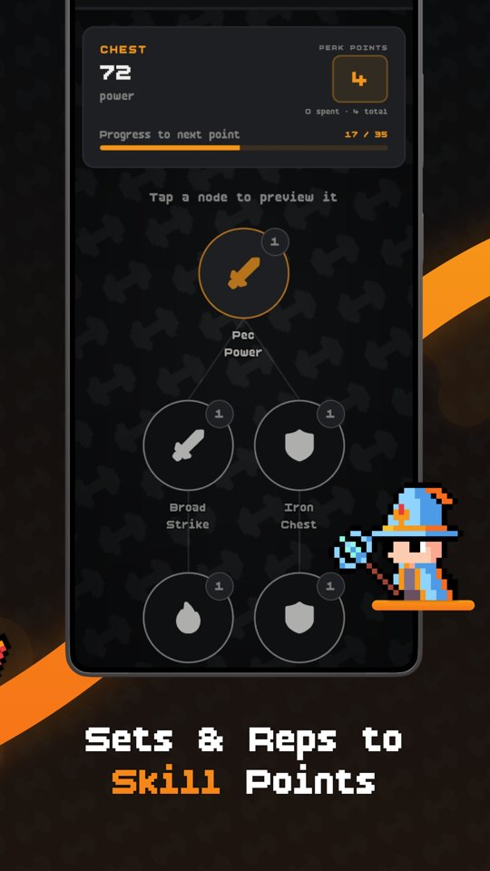
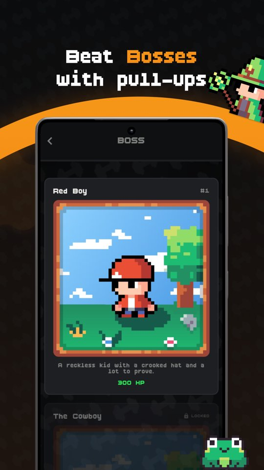
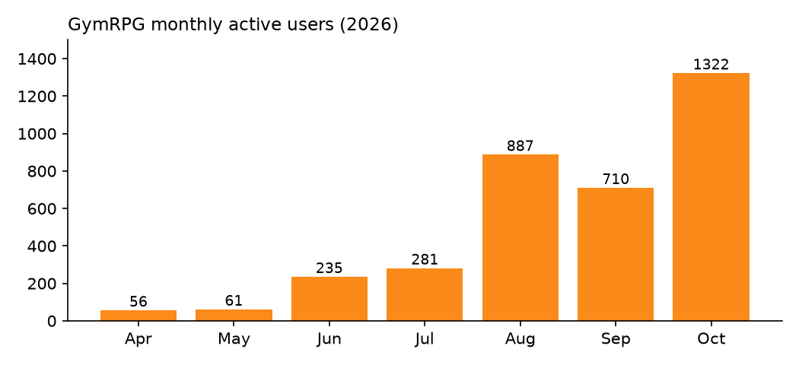

# GYM RPG: a solo-built cross-platform fitness RPG


> Showcase repo. The source code is private. This page documents the product, architecture and engineering decisions.

[Google Play](https://play.google.com/store/apps/details?id=com.jonhy.gymrpg) | [App Store](https://apps.apple.com/app/id6772619769)

## What it is

A fitness tracker that turns training into an RPG: characters, gear, pets, relics, boss battles, parties and streaks. Log workouts and nutrition, earn XP and coins, and fight bosses with friends. I designed, built, shipped and operate it solo.

<p>
  
  
  
  
  
</p>

## Numbers (Oct 2026)

- **1,447** monthly active users, 640 weekly, 151 daily
- Monthly actives grew from 56 (Apr) to 1,300+ (Oct, month to date)
- Users across the US, PT, UA, RU, BR, DE, FI and more; UI in 9 languages
- 5.0 rating on Google Play
- 33 subscribers in the last 90 days
- 145+ builds shipped through an automated release pipeline



*Source: PostHog. October is month to date.*

## Architecture

```
Flutter app (iOS / Android)
   |  Riverpod state, repositories, secure storage
   v
Supabase
   |- Postgres + Row Level Security (access control in the database)
   |- Auth (email, Google)
   |- Edge Functions (Deno/TypeScript): economy mutations, webhooks, push fan-out
   '- Scheduled jobs: streak reminders, re-engagement
RevenueCat --webhook--> entitlement sync
PostHog (analytics), Firebase Cloud Messaging (push)
```

- **Flutter + Riverpod:** one codebase for both stores, testable state notifiers.
- **Server-authoritative economy:** the client is untrusted, so rewards, purchases and combat resolve in edge functions, never on the device.
- **Scale of the codebase:** 60+ edge functions, 360+ SQL migrations, 130+ test files (unit, widget, backend).
- **Release automation:** Fastlane and GitHub Actions for store releases and iOS beta.

## Engineering stories

1. **Server-authoritative game economy** (write-up: coming soon)
2. **Debugging RLS recursion and policy performance in Postgres** (write-up: coming soon)
3. **Shipping to two stores solo: release automation and Apple review** (write-up: coming soon)

## Stack

Flutter, Dart, Riverpod, Supabase (Postgres, Auth, Edge Functions), Deno/TypeScript, RevenueCat, PostHog, Firebase Messaging, Fastlane, GitHub Actions.

## About me

João Azevedo. MSc in Computer Science and Engineering, Instituto Superior Técnico. Based in Portugal, open to remote roles in EU/UK time zones.

[Portfolio](https://joaochartersazevedo.github.io) | [LinkedIn](https://www.linkedin.com/in/joao-charters-azevedo/) | joaochartersazevedo@gmail.com
